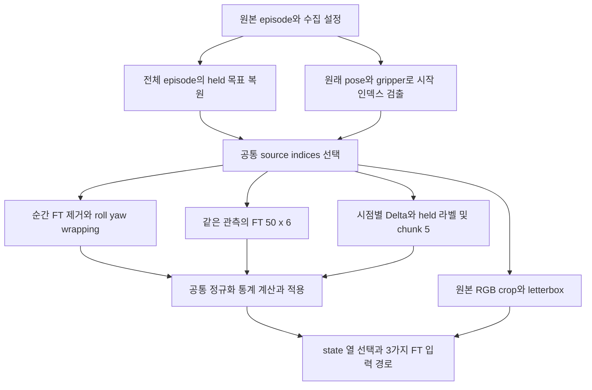

# default_sfm 전처리 명세와 재현 안내

기준일: 2026-10-24 (Asia/Seoul). 이전 결정 기록 커밋: `7d82d00`.
이후 F/T 논의 재개와 정상 0 입력 확인은 이 문서와 동봉한 계획에 반영했다.
재현할 때는 이 문서와 함께 전달된 체크아웃의 전체 커밋 해시를 기록한다.

## 1. 현재 완료 범위와 이 문서의 용도

이 문서는 다른 사람이 **동일한 코드와 설정으로 450개 전처리 및 검증을 재현**하기 위한 안내다.
`experiment_plan.yaml`은 전처리 프로그램이 읽는 확정 명세이며 학습 설정 파일은 아니다.
450개를 변환하는 프로그램과 9개 조건의 공통 데이터 로더를 구현했다.
F/T GRU·AdaLN 모델과 실제 학습 trainer는 별도 작업이며, 이 문서의 명령은 학습을 시작하지 않는다.

| 항목 | 현재 상태 |
|---|---|
| 환경 및 원본 복사 | 완료. 원본 PKL 450개, JSON 67개, 총 517개 파일 |
| 복사 무결성 | 원격 송신·수신·디스크 재읽기 SHA-256 일치 기록 있음 |
| RPY 검사 | 450개 / 143,127프레임 완료 |
| 초기 정지 제거 | 450개 완료. 4,142프레임 제거, 138,985프레임 유지 |
| 초기 F/T 예비 검사 | 9개 표본 검사. 아래 전체 검사로 범위 확대 |
| 전체 F/T·receipt 검사 | 완료. 450개, 원본 143,127프레임 전부 receipt 있음 |
| 학습용 변환 | 450개 완료. 공통 HDF5 26,336,538,496 bytes, 정규화 및 저장 검증 통과 |
| 독립 재읽기·로더 검증 | 450개 해시, 이미지 277,970장, 9개 조건 표본 12,150개 및 2-worker 배치 로딩 통과 |
| optimizer step / 학습 | 0 / 미실행 |

최신 사용자 결정은 **F/T 6축별 standard, `epsilon=0.01`**이다.
정상 0 이력을 통계에 포함하고, 전체 유지 구간에서 구한 같은 계수를 9개 조건에 적용한다.
실제 실행 결과와 파일 위치는 [10절](#10-완료된-v1-실행-기록),
[실행 기록](preprocessing_audit/preprocessing_execution.json),
[최종 검증 결과](preprocessing_audit/processed_verification.json)에서 확인할 수 있다.

## 2. 무엇을 누가 결정했는가

“모든 세부 수치를 사용자가 개별 승인했다”는 뜻으로 이 계획을 해석하면 안 된다.
실험 결정, 기존 구현에서 가져온 세부사항, 구현을 위해 정리한 사항을 아래처럼 구분한다.
구현과 실제 데이터 적용의 완료 여부는 첫 상태 표와 출력 bundle의 `manifest.json`으로 구분한다.

| 항목 | 근거와 범위 |
|---|---|
| `test`, `usb_insert` 제외한 450개 | 사용자 직접 확정 |
| 450개 모두 학습, 별도 평가 | 사용자 직접 확정. 내부 train/validation 분할 없음 |
| F/T 50×6 전체 사용, state의 순간 F/T 6축 제거 | 사용자 직접 확정 |
| flat / 기존 TurboVLA USB GRU / GRU+AdaLN | 사용자 직접 확정 |
| XY 유지 / x·y 제거 / x·y·vx·vy 제거 | 사용자 직접 확정 |
| 원본 crop, 기존 USB 영역, 224×224 letterbox | 사용자 직접 확정 |
| roll·yaw만 `[0,2π)`, pitch 부호 유지 | 사용자 직접 확정 |
| base-frame Delta, chunk 5, held gripper | 사용자 직접 확정 |
| state 축별 standard, action `symlog_minmax` | 사용자 직접 확정 |
| F/T 정규화 | 사용자 최종 확정: 6축별 standard, 분모 하한 0.01 |
| 전체가 0인 F/T 이력 | 사용자가 의도된 정상 입력이라고 확인. 유지하고 통계에 포함하며 제거·보간하지 않음 |
| 초기 정지 판정과 앞 2프레임 보존 | 사용자가 “기존에 처리했던 것과 똑같이”로 확정 |
| task별 9개 영문 문장, clockwise의 조작면 정면 기준 | 사용자 직접 제공·확정 |
| resize의 `INTER_AREA`, padding 28, action 온도 20·epsilon 1e-6 | 선택한 기존 USB/csilab 구현에서 확인한 세부사항 |
| 표시용 `[USB]` 등의 라벨과 Markdown 강조 제외 | 문장 내용을 보존하기 위한 기록상의 해석. 별도로 질문하지 않았음 |
| p1~p5와 9개 조건에 같은 task 문장 사용 | 제공된 task별 매핑에서 도출한 구현 규칙. 문장에 위치 번호를 추가하지 않음 |
| 먼저 공통 통계를 계산하고 state 열만 선택 | 공통 정규화와 실험 비교를 구현하기 위해 기록한 규칙 |
| held 라벨 복원 후 앞부분 제거 | 앞부분의 gripper 명령을 잃지 않기 위한 기존 처리 순서 |
| F/T 시간 순서, population std, padding mask | 기존 구현과 데이터 구조에서 확인할 구현 계약. 새로운 데이터 보정 정책이 아님 |

환경 요청에 따라 `pyproject.toml`의 `real_robot` 의존성, 환경·복사·검사 도구, 문서와 감사 기록을 추가했다.
GitHub 원격 변경과 push는 사용자 요청·승인 범위에서 수행했다.
감사 시점의 `e946c43..7d82d00` 비교에서 `turbovla/`, `configs/`의 실제 모델·학습 코드는 변경되지 않았다.
이번에는 `turbovla/data/sfm_preprocessing.py`, `turbovla/data/default_sfm.py`와 전처리·검증 CLI를 추가했다.
참조용 복사본은 감사 디렉터리에 있으며, 실제 모델 구조·학습 코드는 아직 변경하지 않았다.
`.gitignore`의 기존 `*.png` 규칙은 유지했고, `.gitattributes`는 참조 파일의 바이트 보존용이다.

근거: [변경 및 원본 확인 기록](preprocessing_audit/change_and_reference_audit.json).
위 변경 감사는 전처리 구현 전의 시점 기록이다. 이번 전체 변환에서는 원본 PKL 450개와 JSON 67개의
SHA-256을 다시 계산해 복사 manifest와 모두 대조했으며, 원본 파일을 수정하지 않았다.

## 3. csilab 참조와 그대로 복사하면 안 되는 기본값

원격 참조 위치는 `csilab:/home/csilab/share_projects/clean_share`다.
현재 원격을 읽기 전용으로 재확인했고, 아래 기존 참조 네 파일의 SHA-256이 일치했다.

| 참조 | 확인한 내용 |
|---|---|
| [convert.py](preprocessing_audit/csilab_source_snapshot/preprocess/convert.py) | `crop_start`, `StateDecoder.selected`, `image_sample` |
| [normalization.py](preprocessing_audit/csilab_source_snapshot/preprocess/normalization.py) | population mean/std, symlog/minmax, mask 제외 통계 |
| [action_chunks.py](preprocessing_audit/csilab_source_snapshot/preprocess/action_chunks.py) | 시점별 Delta, H=5로 설정할 chunk, tail mask |
| [config_right_default.yaml](preprocessing_audit/csilab_source_snapshot/preprocess/configs/config_right_default.yaml) | 기존 초기 정지 설정, 일반 정규화 기본값 |
| [최신 csilab gripper.py](preprocessing_audit/csilab_handoff_source/preprocess/gripper.py) | 명령 복원과 실제 next-state 라벨을 구분해야 함 |
| [FAFLOW held 참조](preprocessing_audit/faflow_held_reference/gripper.py) | 이번 held 명령 라벨과 전체 프레임 대조에 사용하는 고정 버전 |
| [episode_recording.py](preprocessing_audit/csilab_handoff_source/Real_Robo/episode_recording.py) | action 표현 encode/decode 경로 |

파일별 해시는 [csilab_reference_recheck.json](preprocessing_audit/csilab_reference_recheck.json)에 있다.
참조 파일은 설명·검사용 snapshot이며 필요한 외부 모듈까지 포함한 독립 실행 패키지가 아니다.

**csilab 기본 YAML 자체를 이번 설정으로 실행하지 않는다.** 기본값에는 `relative`, chunk 50,
RPY wrapping 비활성화가 있다. 이번 확정값은 `delta`, chunk 5, `wrap_angles: [roll, yaw]`다.
그리퍼도 관측값 기반 label version 2로 자동 전환하지 않고, 확정된 명령 유지 의미를 보존해야 한다.

## 4. 입력 데이터와 task 지시문

- 원격 요청 경로: `/home/csilab/share_projects/clean_share/demos/default_sfm`
- 원격 실제 저장 경로: `/media/csilab/robot_data/default_sfm`
- 이 서버 원본 사본: `/data/crestlux/default_sfm`
- 저장소 링크: `data/default_sfm`
- 9 tasks × 5 placements × 10 demos = 450 demos. 총 529,275,940,616 bytes.
- `task_p1` … `task_p5`의 `p` 숫자는 배치 메타데이터다. 언어 지시문에 넣지 않는다.

| 폴더 prefix | 모델에 전달할 원문 |
|---|---|
| `usb` | Insert USB connector into USB port |
| `lan` | Insert LAN cable into Ethernet port |
| `bnc` | Insert BNC connector and rotate clockwise |
| `hdmi` | Insert HDMI connector into HDMI port |
| `audio_jack` | Insert audio jack into audio port |
| `rotary_switch` | Grasp rotary switch and rotate clockwise |
| `outlet` | Insert adapter into outlet |
| `knob` | Grasp knob and rotate clockwise |
| `barlatch` | Grasp bar latch and rotate clockwise |

네 회전 task의 clockwise는 각 부품의 조작면을 정면에서 바라볼 때의 시계방향이다.
별도 평가의 회전 종료 각도·성공 상태까지 이 문장이 정의하는 것은 아니다.

관측 하나의 주요 배열:

| 원본 key | shape | 의미 |
|---|---|---|
| `observations/state` | `[1,19]` | 현재 gripper, 순간 F/T, TCP pose, velocity |
| `observations/right_force_history` | `[1,50,6]` | 현재 관측에 속한 F/T 이력 |
| `observations/right_state_history` | `[1,50,19]` | 기록된 state history; 이번 state 입력으로 통째로 사용하지 않음 |
| `observations/head_cam_d455` | `[1,480,640,3]`, uint8 | RGB head image |
| `observations/wrist_cam_d405_a` | `[1,480,640,3]`, uint8 | RGB wrist image |
| `actions` | `[7]` | 절대 TCP 목표 xyz/rpy와 원본 gripper 명령 |

실제 action 의미는 각 row의 `infos.action_format`에서 `absolute_tcp_xyz_rpy_gripper`로 확인했다.
수집 JSON의 서버 설정 이름만 보고 저장된 actions가 이미 Delta라고 해석하지 않는다.

F/T 500 Hz는 사용자 제공 센서 주기다. 50 samples는 명목상 약 100 ms이고 제어 관측은 약 10 Hz다.
센서 sample별 timestamp까지 검증한 것은 아니다. 시간 재샘플링·보간을 새로 적용하지 않는다.

## 5. 전처리 순서

아래 순서는 구현한 변환기의 처리 순서다. 완료 bundle은 전체 파일 검증 뒤에만 `manifest.json`의 `complete=true`로 게시한다.



### 5.1 초기 정지 제거

원래 관측의 전체 TCP pose와 gripper를 사용한다. XY ablation이나 정규화보다 먼저 판정한다.

```yaml
enabled: true
pose_keys: [right/tcp_pose]
gripper_keys: [right/gripper_pose]
translation_threshold_m: 0.01
rotation_threshold_rad: 0.01
gripper_threshold: 0.02
consecutive_frames: 3
pre_roll_frames: 2
no_motion: drop
```

첫 관측과 비교해 아래 중 하나를 **초과(`>`)**하면 해당 프레임이 기준을 만족한다.

1. xyz 이동 거리의 Euclidean norm > 0.01 m.
2. `Rotation.from_euler('xyz', rpy)`의 첫 자세 대비 상대 회전 크기 > 0.01 rad.
3. gripper 관측 열림 정도 변화의 절댓값 > 0.02.

3프레임 연속 만족하는 첫 구간의 시작을 `m`이라 하면 `start=max(0,m-2)`다.
`rows[start:]`를 유지한다. 순간 속도나 action이 0인지로 판정하는 방식이 아니다.
첫 자세에서 이동한 채 멈춘 상태도 이 변위 기준을 만족할 수 있다.
중간 정지·접촉 유지·마지막 정지 구간을 추가로 제거하지 않는다.
회전은 기하학적 회전 차이로 계산하므로 Euler ±π 경계 자체를 동작으로 오인하지 않는다.

현재 450개 진단 결과는 [initial_stationary_audit.json](preprocessing_audit/initial_stationary_audit.json)에 있다.
모든 데모에서 시작점이 검출됐고 제외된 데모는 0개다.
실제 전체 변환에서도 143,127개 중 4,142개를 제거해 138,985개를 저장했으며 사전 진단과 일치했다.

### 5.2 held gripper

초기 정지 제거 **이전의 전체 episode**에서 명령을 복원한 뒤 같은 source indices로 선택한다.
기본 정보는 `infos.command_receipts.right.gripper_target_percent`다.

- 0% → 닫힘 `-1`, 100% → 열림 `+1`.
- 새 명령이 없으면 직전 명령 목표를 유지한다.
- 초기 관측 opening은 450개 모두 1.0이었다. 기존 로직의 초기 목표는 여기서 출발하며 같은 프레임의 receipt가 있으면 이를 우선한다.
- 관측한 gripper 폭을 매 프레임 action 라벨로 치환하지 않는다.

**이전 문서의 옵션 설명을 정정한다.** 최신 csilab의 `LegacyGripperLabels`는
명령을 `commands`에 복원하지만 `mode=absolute`의 `labels`에는 **다음 관측값**을 넣는다.
따라서 `label_version=1, mode=absolute`만 지정하면 held 라벨이 된다는 이전 설명은 잘못됐다.

이번 구현은 위에서 확정한 receipt 기반 held 규칙을 직접 구현하며,
[고정된 FAFLOW 참조](preprocessing_audit/faflow_held_reference/gripper.py)의 결과와 전 프레임을 대조한다.
이 FAFLOW 버전은 `mode=absolute, grasp.enabled=false`에서 `labels=commands`다.

receipt가 없으면 기존 binary command 기준(close ≤ -0.5 / open ≥ +0.5)을 사용하며,
custom-width 기록은 receipt 없이 복원하지 않는다. 중간 목표값은 임의로 ±1로 반올림하지 않고 오류로 보고한다.
전체 450개 사전 검사에서 원본 143,127프레임 **모두 receipt가 있었고 fallback은 0개**였다.

### 5.3 이미지

원본 640×480 RGB에서 먼저 잘라낸다. 좌표는 원본 기준이고 끝 인덱스는 제외한다.

| 카메라 | NumPy crop | `(top,left,height,width)` |
|---|---|---|
| head | `image[96:384,128:512]` | `(96,128,288,384)` |
| wrist | `image[72:408,122:570]` | `(72,122,336,448)` |

두 crop 모두 4:3이다. `cv2.INTER_AREA`로 width 224, height 168로 줄이고,
위아래 28픽셀씩 0으로 채워 224×224 RGB를 만든다. 출력 HWC 기준 `[224,224,3]`이다.
원본 전체를 먼저 224×224로 줄였다가 확대·crop하는 과거 FAFLOW 경로를 재사용하지 않는다.
현재 설정에는 새로운 색상 변환·CLAHE·회전·이미지 증강을 추가하지 않았다. 학습 증강은 별도 미정이다.

### 5.4 state와 RPY

원본 19개 열 순서:

| 인덱스 | 성분 |
|---|---|
| 0 | gripper observed opening |
| 1,2,3 | 순간 Fx,Fy,Fz |
| 4,5,6 | TCP x,y,z |
| 7,8,9 | TCP roll,pitch,yaw |
| 10,11,12 | 순간 Tx,Ty,Tz |
| 13,14,15 | vx,vy,vz |
| 16,17,18 | wx,wy,wz |

모든 조건에서 순간 F/T 인덱스 `[1,2,3,10,11,12]`를 제거한다.
roll과 yaw에만 modulo `2π`를 적용하고 pitch는 원래 signed angle을 유지한다.
csilab과 같이 float32에서 상한 2π가 포함되지 않도록 `nextafter(float32(2π),0)`를 상한으로 사용한다.
연속각 `unwrap`을 적용하는 것이 아니다. 새로운 데이터에서 생기는 0/2π 경계 문제를 자동으로 다른 방식으로 보정하지 않는다.

wrapping 후 공통 state 축별 평균·표준편차를 계산한다. csilab 일반 standard는 population std(`ddof=0`)와
`scale=max(std,epsilon)`을 쓰며 참조 epsilon은 `1e-6`이다. 이는 기존 코드의 수치 처리 세부사항이다.
세 조건은 공통 통계에서 필요한 열을 선택하며 조건마다 통계를 다시 추정하지 않는다.

| 조건 | 유지할 원본 인덱스 | state 차원 |
|---|---|---:|
| `xy_keep` | `[0,4,5,6,7,8,9,13,14,15,16,17,18]` | 13 |
| `xy_remove` | `[0,6,7,8,9,13,14,15,16,17,18]` | 11 |
| `xy_vxy_remove` | `[0,6,7,8,9,15,16,17,18]` | 9 |

세 번째 조건에서도 vz와 wx·wy·wz는 남긴다. 이 제거는 **모델의 state 입력**에만 적용한다.
초기 정지 검출이나 Delta 라벨 계산에 필요한 원래 x·y는 그대로 사용하며 action의 x·y를 제거하지 않는다.

### 5.5 F/T: 확정된 공통 표준화

현재 관측의 `right_force_history`에서 leading observation 차원만 제거해 `[50,6]`을 사용한다.
시간 순서는 oldest-to-newest, 채널은 `[Fx,Fy,Fz,Tx,Ty,Tz]`다. 필터·보간·재샘플링을 추가하지 않는다.
전체 학습 데이터의 유지된 관측과 50개 history sample을 합쳐 **6쌍**의 평균·population std를 계산한다.
시간 위치마다 300쌍을 따로 계산하지 않는다. 정상 0도 전부 포함한다.

```text
z[..., c] = (ft[..., c] - mean[c]) / max(std[c], 0.01)
```

최신 사용자 답변으로 `epsilon=0.01`을 확정했다. 9개 조건에 같은 계수를 쓰고 정규화는 한 번만 한다.
**저장된 F/T가 이미 정규화되므로 기존 USB GRU의 모델 내부 정규화를 다시 적용하면 안 된다.**
모듈 구조의 GRU/Linear/LayerNorm은 그대로 재사용할 수 있지만 입력 정규화 위치는 이 계약을 따라야 한다.

전체 숫자 사전 검사 결과는 다음과 같다. 실제 전체 변환에서 계산한 계수와 정확히 일치했다.

| 축 | 전체 유지 구간의 std | 적용한 분모 |
|---|---:|---:|
| Fx | 0.3870765015 | 0.3870765015 |
| Fy | 0.3791904228 | 0.3791904228 |
| Fz | 3.3384654647 | 3.3384654647 |
| Tx | 0.0079601053 | 0.01 |
| Ty | 0.0044441420 | 0.01 |
| Tz | 0.0518655978 | 0.0518655978 |

통계 표본 수는 축마다 **6,949,250개 = 138,985 × 50**이다.
유지된 관측 중 `[50,6]` 전체가 0인 것은 **111,350개(약 80.12%)**이며 사용자가 확인한 정상 입력이다.
제거·보간·결측 mask를 적용하지 않는다. 표준화 후 원래 0은 `-mean/scale`로 이동하며 그 의미는 유지된다.
원래 0 window만 다시 숫자 0으로 강제하는 예외 처리를 넣지 않는다.

근거: [전체 숫자 검사](preprocessing_audit/full_numeric_preflight.json).
이전 [9개 예비 검사](preprocessing_audit/ft_standardization_pilot.json)의 78.4%는 표본 비율이며 전체 수치와 구분한다.
센서별 timestamp는 원본에 없어서 실제 500 Hz 타이밍까지 검증한 것은 아니다. 관측 시간의 단조 증가는 검사한다.

### 5.6 Delta와 action chunk

각 원본 시점 `j`의 관측 pose와 같은 시점의 절대 목표를 사용한다.

```text
delta_xyz[j] = target_xyz[j] - observed_xyz[j]
delta_rotation[j] = rotvec(R_target[j] @ R_observed[j].T)
action[j] = [delta_xyz[j], delta_rotation[j], held_gripper[j]]
```

좌표계는 robot base, 위치는 m, 회전은 rad다. 제어 주기로 나누지 않는다.
RPY의 성분별 차이를 action 회전으로 사용하지 않는다. state의 roll/yaw wrapping은 이 기하학적 계산을 바꾸지 않는다.

관측 `t`의 target chunk는 `[action[t],...,action[t+4]]`, shape `[5,7]`이다.
각 action은 자기 시점의 관측 pose를 기준으로 계산한다. chunk의 첫 pose를 다섯 action의 공통 기준으로 쓰지 않는다.
명목상 10 Hz에서 5개 제어 명령은 0.5초 분량이다. 실제 한 번에 실행할 개수는 별도 inference 설정이다.

episode 끝의 부족한 항목은 기존 csilab처럼 mask=false로 두고 정규화 **후** 0으로 채운다.
mask=false 항목은 통계와 loss에서 제외하며 다른 episode의 action으로 채우지 않는다.
전체 변환의 valid action chunk 원소는 690,425개이며, 저장된 모든 mask와 padding을 검사했다.

### 5.7 공통 정규화

정규화 계수는 새로운 SFM 데이터의 **유지된 학습 프레임**에서 계산한다.
과거 USB의 수치 계수를 재사용하지 않는다. 모든 task와 배치 및 9개 실험이 같은 계수를 공유한다.
state와 F/T는 각각 독립된 통계다. state의 순간 F/T 6개를 중복 입력하거나 다시 정규화하지 않는다.

action의 pose 6축은 기존 USB `symlog_minmax`를 사용한다. 채널마다 아래와 같다.

```text
offset = (min + max) / 2
scale = max((max - min) / 2, 1e-6)
u = (a - offset) / scale
z = sign(u) * log1p(20 * abs(u)) / log1p(20)

# inverse
u = sign(z) * expm1(abs(z) * log1p(20)) / 20
a = u * scale + offset
```

min/max는 mask=true인 실제 action에서 구한다. 이 구현은 값에 새 clipping을 추가하지 않는다.
held gripper의 -1/+1 라벨은 그대로 유지한다. 관측 gripper state의 표준화와 action gripper 처리를 혼동하지 않는다.
현재·다음 관측을 저장할 때와 추론 때도 학습에서 계산한 동일 계수를 사용한다.

## 6. 9개 모델 조건의 경계

공통 image, instruction, target action, source indices, 정규화 계수는 같다.
F/T 변환 방법 3개와 state 조건 3개를 조합한다.

| F/T 경로 | XY 유지 | x·y 제거 | x·y·vx·vy 제거 |
|---|---|---|---|
| full history flat + state embedding | `ft_state_xy_keep` (313) | `ft_state_xy_remove` (311) | `ft_state_xy_vxy_remove` (309) |
| TurboVLA USB GRU token | `ft_gru_xy_keep` (13) | `ft_gru_xy_remove` (11) | `ft_gru_xy_vxy_remove` (9) |
| 같은 GRU token + ACT decoder AdaLN | `ft_gru_adaln_xy_keep` (13) | `ft_gru_adaln_xy_remove` (11) | `ft_gru_adaln_xy_vxy_remove` (9) |

괄호는 flat 조건에서는 state+FT 입력 차원, GRU 조건에서는 별도 state 입력 차원이다.
flat은 `[50,6]`을 시간 순서대로 펼친 300차원을 state에 연결한다.
GRU는 기존 TurboVLA USB의 1-layer `GRU(6,128)`, window마다 zero hidden reset,
마지막 hidden → Linear(128,256) → LayerNorm → `[B,1,256]` memory token 구조를 따른다.
GRU+AdaLN은 이 token을 유지하고 같은 GRU 출력으로 ACT decoder LayerNorm의 scale·shift를 조건화한다.
AdaLN 초기화와 학습 초기 가중치·동결 정책은 아직 미정이다. F/T 분모 하한은 사용자 확정값 0.01이다.

## 7. 지금 실행할 수 있는 재현 절차

아래 명령은 환경 설치·원본 복사 또는 진단을 위한 것이다. 학습 데이터 변환이나 학습을 시작하지 않는다.
이미 있는 원본을 덮어쓰거나 참조 기록을 갱신하는 대신 새 `tmp/default_sfm_reproduction` 아래에 결과를 남긴다.

### 7.1 저장소와 환경

```bash
git clone https://github.com/crestlux/TurboVLA_Skill.git
cd TurboVLA_Skill
mkdir -p tmp/default_sfm_reproduction
git rev-parse HEAD > tmp/default_sfm_reproduction/code_commit.txt

conda create -n turbovla-sfm-repro python=3.10.22 pip rsync=3.4.4 -y
conda activate turbovla-sfm-repro
python -m pip install --extra-index-url https://download.pytorch.org/whl/cu124 \
  -r scripts/default_sfm/requirements-reproduction.txt
python -m pip install --no-deps -e .
python -m pip check
```

대상 환경은 Linux x86_64 / Python 3.10.22 / Torch 2.6.0+cu124 / torchvision 0.21.0+cu124다.
이전 `pip-freeze.txt`에는 원래 Git URL의 editable 항목과 conda build 머신의 `file://` 경로가 있으므로
그 파일을 그대로 `pip install -r`로 실행하지 않는다. 새 portable 요구사항은 설치된 77개 배포판의 버전에서 만들었다.
현재 머신에서는 의존성 변경 없이 검사했다. 새 머신의 다운로드·설치는 그 머신에서 검증해야 한다.
기본 환경 설치 도구는 별도로 `scripts/default_sfm/setup_env.sh`에 있다.

숫자 진단에는 GPU나 사전학습 backbone이 필요 없다.
모델 환경까지 검증하려면 `pretrained/backbones/dinov3-vitb16`, `pretrained/backbones/bert-base-uncased`를 준비하고
`setup_records/backbone_manifest.json`의 파일 해시와 맞춘다. 기존 머신의 symlink 대상은 Git에 포함되지 않는다.
이후 GPU 호스트에서 다음 명령으로 synthetic forward를 검사할 수 있다.

```bash
python scripts/default_sfm/check_environment.py \
  --output tmp/default_sfm_reproduction/environment.json
```

이 검사는 학습 설정이나 pretrained action checkpoint 선택을 뜻하지 않는다.

### 7.2 원본 준비와 검증

원본 데이터와 진단용 NPZ, 이미지 미리보기, 모델 weights는 Git 저장소에 포함되지 않는다.
새 담당자는 원본 저장소에 대한 읽기 권한과 `csilab` SSH 별칭을 별도로 준비한다. 비밀번호를 문서나 Git에 넣지 않는다.
원본 복사에는 양쪽 머신의 `ssh`·`zstd` 실행 파일이 필요하다.

```bash
python scripts/default_sfm/copy_data.py \
  --inventory experiments/default_sfm/setup_records/source_inventory.json \
  --host csilab \
  --destination /data/crestlux/default_sfm \
  --records tmp/default_sfm_reproduction/copy
```

새 머신은 destination을 그 머신의 **새 원본 사본 경로**로 바꾼다. 원격 경로는 inventory에 기록돼 있다.
복사 도구는 45개 task/배치 폴더만 선택하고, 원본을 읽어 송신·수신 SHA-256을 검증한다.

```bash
mkdir -p data
ln -s /data/crestlux/default_sfm data/default_sfm

python scripts/default_sfm/inventory.py \
  --root data/default_sfm --sha256 --workers 2 \
  --compare experiments/default_sfm/setup_records/copy_manifest.json \
  --output tmp/default_sfm_reproduction/raw_hash_check.json
python - <<'PY'
import json
from pathlib import Path
d = json.loads(Path('tmp/default_sfm_reproduction/raw_hash_check.json').read_text())
assert d['verification']['status'] == 'verified', d['verification']
assert (d['demo_count'], d['file_count']) == (450, 517)
print('Exact cohort paths, sizes and SHA-256 match.')
PY
```

이미 `data/default_sfm`이 있으면 `ln -s`를 반복하거나 강제로 교체하지 말고 `readlink -f data/default_sfm`으로 확인한다.
전체 해시 검사는 약 529 GB를 다시 읽는다. 빠른 경로·크기 검사만 했다면 이를 내용 해시 검증으로 보고하지 않는다.

### 7.3 RPY 숫자 추출과 초기 정지 결과 재현

새 머신은 Git에 없는 숫자 캐시를 먼저 재생성한다.

```bash
python scripts/default_sfm/audit_rpy.py \
  --root data/default_sfm \
  --inventory experiments/default_sfm/setup_records/source_inventory.json \
  --output tmp/default_sfm_reproduction/rpy --workers 2

python scripts/default_sfm/reproduce_initial_stationary.py \
  --raw-root data/default_sfm \
  --numeric-root tmp/default_sfm_reproduction/rpy \
  --output tmp/default_sfm_reproduction/initial_stationary.json
```

이미 이 머신의 `preprocessing_audit/rpy/numeric/`가 있다면 다음 한 명령으로 초기 정지 결과를 재현할 수 있다.

```bash
python scripts/default_sfm/reproduce_initial_stationary.py \
  --output tmp/default_sfm_reproduction/initial_stationary_from_cache.json
```

이 스크립트는 해시를 확인한 csilab의 `numeric`, `crop_start` 함수만 사용한다.
450개 각 demo의 시작 인덱스를 저장된 결과와 비교하고 독립 계산으로도 확인한다.
새 출력 파일만 허용하며 원본 디렉터리 안에 진단 결과를 쓰지 않는다.
기대 결과는 `450 demos`, `no_motion_demos=0`, `143127 original`, `4142 removed`, `138985 retained`다.

RPY 진단의 image 버퍼는 숫자 검사 속도를 위해 대체된다. 그 객체의 이미지를 학습이나 미리보기에 사용하면 안 된다.
이 캐시는 state/action/time 진단용이며 F/T·receipt·원본 RGB를 갖춘 학습 데이터가 아니다.

### 7.4 F/T 논의용 예비 검사 재현

```bash
python scripts/default_sfm/audit_ft_pilot.py \
  --raw-root data/default_sfm \
  --output tmp/default_sfm_reproduction/ft_pilot.json
```

9개 task 각각의 p1에서 파일명 기준 첫 PKL을 읽는다. 확정된 초기 trim 인덱스를 사용하지만 실제 파일을 자르지 않는다.
현재 원본의 기대 값은 `9 demos`, `2971 retained windows`, `2330 all-zero windows`다.
일치하지 않으면 원본 버전·selection·시작 인덱스를 먼저 대조한다. 결과를 맞추기 위해 데이터를 수정하지 않는다.

## 8. 전체 변환과 검증 실행

완료된 환경을 활성화한 뒤 저장소 root에서 실행한다. output은 **존재하지 않는 새 경로**여야 한다.
프로그램은 원본 안에 출력하거나 기존 결과를 덮어쓰는 것을 거부한다.
현재 호스트의 `sfm_delta_h5_ftstd001_v1`은 이미 완료된 결과이므로 재현 실행에서는 새 출력 경로를 사용한다.

```bash
python scripts/default_sfm/test_preprocessing.py -v

python scripts/default_sfm/preprocess.py \
  --raw-root /data/crestlux/default_sfm \
  --output /data/crestlux/default_sfm_processed/sfm_delta_h5_ftstd001_reproduction \
  --workers 2

python scripts/default_sfm/verify_preprocessed.py \
  --dataset /data/crestlux/default_sfm_processed/sfm_delta_h5_ftstd001_reproduction \
  --numeric-preflight experiments/default_sfm/preprocessing_audit/full_numeric_preflight.json \
  --rehash \
  --output tmp/default_sfm_reproduction/processed_verification.json
```

full numeric preflight를 새로 만들려면 `preflight_numeric.py --output <새 JSON>`을 실행한다.
`--limit-demos 2`는 별도 smoke 출력용이며 그 계수를 전체 학습에 재사용하지 않는다.
완료된 v1의 검증 기준은 유지 프레임 138,985개, valid action chunk 원소 690,425개다.
다중 worker 로더 검사는 로컬 프로세스 IPC를 허용하는 환경에서 실행한다. GPU나 학습은 사용하지 않는다.

변환기는 모든 원본 PKL을 일반 pickle reader로 읽으면서 SHA-256을 복사 manifest와 대조한다.
이미지 바이트를 대체하는 `NumericAuditReader`는 숫자 사전 검사에서만 사용하며 실제 변환에는 사용하지 않는다.
모든 유지 프레임의 이미지 결과를 csilab `image_sample`과 픽셀 단위로 비교하고 HDF5 재읽기 해시를 검사한다.
held 라벨은 고정 FAFLOW 참조, 시작 인덱스는 csilab 참조 및 기존 전체 진단과 비교한다.
정규화 뒤에는 실제 저장된 float32를 역변환하여 state, FT와 절대 action 목표 복원을 검사한다.

처리 중에는 output의 `status.json`에서 단계와 완료 개수를 확인한다. `manifest.json`이 없거나
`complete=true`가 아니면 완료 데이터로 사용하지 않는다. 실패 출력은 자동 덮어쓰기·삭제하지 않는다.

## 9. 출력 bundle과 9개 조건의 데이터 로더

공통 파일 450개를 저장하고 9개 조건에서 같은 파일을 읽는다. 9벌의 이미지 사본을 만들지 않는다.

| 파일/배열 | 의미 |
|---|---|
| `episodes/episode_XXXX.h5` | episode 하나, 원본 및 source index 대응 유지 |
| `observations/image_head`, `image_wrist_right` | `[T,224,224,3]`, RGB uint8, native crop 결과 |
| `observations/state` | `[T,13]`, 순간 FT 제거·roll/yaw wrap·공통 standard 적용 |
| `observations/ft_history` | `[T,50,6]`, 공통 standard와 floor 0.01 적용 완료 |
| `actions`, `action_mask` | `[T,5,7]`, `[T,5]`; pose symlog_minmax, held gripper, tail zero |
| `source_state`, `source_actions`, `ft_history_raw`, `delta_actions` | 역변환 검증을 위한 물리 단위 근거 |
| `source_indices`, `timestamps`, `terminals` | 원본 frame 대응과 episode 경계 |
| `normalization.json` | 전체 450개의 실제 공통 계수와 표본 수 |
| `data_contract.json`, `inference_config.json` | shape, 순서, 역변환, 9개 조건 및 추론 입력 계약 |
| `variants/*.json` | 공통 state에서 선택할 열과 flat/GRU 입력 구분 |
| `manifest.json` | 완료 상태, task/배치/지시문, shard SHA-256, 통계 해시 |
| `run.json`, `source_snapshot/` | 실행 명령, 코드 commit 및 실제 사용한 코드/명세 해시 |

현재 관측만 학습 입력으로 저장하고 `next_observations` RGB는 중복 저장하지 않는다.
원본 PKL에는 다음 관측이 그대로 남는다. 학습용 숫자는 float32, 감사용 원래 action 및 Delta는 원래 정밀도를 보존한다.
HDF5의 LZF 압축은 무손실이며, RGB에 JPEG 등 추가 손실 압축을 적용하지 않는다.

```python
from turbovla.data.default_sfm import DefaultSFMDataset

dataset = DefaultSFMDataset(
    '/data/crestlux/default_sfm_processed/sfm_delta_h5_ftstd001_v1',
    variant='ft_gru_xy_vxy_remove',
)
sample = dataset[0]
# images: [2,3,224,224] uint8, camera order=[head,wrist]
# state: [9], ft_history: [50,6], actions: [5,7], action_mask: [5]
# instruction: task별 원문. images의 backbone tensor 정규화는 모델 단계에서 수행.
dataset.close()
```

flat 조건은 state 뒤에 시간 순서대로 펼친 FT300을 연결한다. GRU 및 GRU+AdaLN 조건은
state와 이미 정규화된 FT50×6을 별도로 반환한다. 별도의 dropout·FT 제거·증강을 추가하지 않는다.

이 데이터 로더의 준비는 실제 GRU/AdaLN 모델과 trainer 구현 완료를 뜻하지 않는다.
학습 초기 가중치·동결 범위, optimizer·학습량·seed·샘플링, 증강, AdaLN 초기화,
실제 execution horizon과 별도 평가 성공 기준은 이후 학습·평가 단계에서 정한다. 학습은 시작하지 않았다.

## 10. 완료된 v1 실행 기록

전체 변환은 2026-10-24 20:39~21:41 KST에 실행됐으며 약 62.85분이 걸렸다.
별도 재읽기·로더 검증은 같은 날 21:51 KST에 통과했다. 원본 변경과 optimizer step은 모두 0이다.

| 항목 | 실제 결과 |
|---|---|
| 원본 | PKL 450개 + JSON 67개, SHA-256 모두 대조 |
| episode / task / 배치 | 450 / 9 / task별 5배치, 배치마다 10개 |
| 프레임 | 143,127 → 138,985, 초기 4,142개 제거 |
| 정상 0 F/T 이력 | 유지 구간 111,350개, 삭제·보간 없이 통계에 포함 |
| valid action chunk 원소 | 690,425개, H=5, 각 원소 7차원 |
| 공통 출력 | HDF5 450개, 26,336,538,496 bytes (약 26.34 GB) |
| state / F/T / action 통계 | 독립적인 전체 숫자 사전 검사와 정확히 일치 |
| held 라벨 | 원본 전 프레임 receipt 있음, fallback 0, 고정 FAFLOW 참조와 일치 |
| 이미지 | 모든 유지 프레임에서 csilab crop/resize 참조와 픽셀 일치 |
| 독립 재읽기 | HDF5 SHA-256 450개, 이미지 277,970장 일치 |
| 9개 데이터 입력 조건 | 표본 12,150개와 각 조건의 2-worker 배치 로딩 통과 |
| 저장 action 역변환 최대 오차 | 위치 4.76e-9 m 미만, 회전 9.53e-9 rad 미만 |

실제 출력은 `/data/crestlux/default_sfm_processed/sfm_delta_h5_ftstd001_v1`이고
프로젝트에서는 `data/default_sfm_preprocessed` symlink로 접근한다. 원본 symlink는 `data/default_sfm`이다.
진행 및 완료 상태는 `python scripts/default_sfm/status.py`로 확인한다.

변환에 사용한 코드 커밋은 **`9bebb80966ced629e484f8d7786ad93451d48ecb`**이다.
실행 당시 소스·설정 16개 파일의 해시가 해당 Git 커밋 및 출력의 `source_snapshot/`과 일치한다.
현재 계획의 `preprocessing_applied`, `rpy.applied`, `common_normalization.fitted`는 완료 상태로 갱신했다.
실행 당시 계획은 출력의 `preprocessing_config.json`에 원형대로 보존했으며 상태 필드 차이가 처리 규칙 변경은 아니다.

Git에는 코드·문서와 [실제 출력 메타데이터](preprocessing_output/README.md)만 저장한다.
다른 사람이 재현하려면 저장소, 450개 원본과 67개 JSON, 위 환경을 함께 전달하고 8절의 새 출력 경로로 실행한다.
이미 완료된 결과를 바로 사용하려면 실제 출력 디렉터리 전체를 전달해야 한다.
Git의 메타데이터 복사본에는 HDF5가 없으므로 로더 root로 사용할 수 없다.

근거: [실행 요약 및 해시](preprocessing_audit/preprocessing_execution.json),
[전체 검증](preprocessing_audit/processed_verification.json),
[구현·smoke·소스 커밋 검증](preprocessing_audit/implementation_validation.json).
